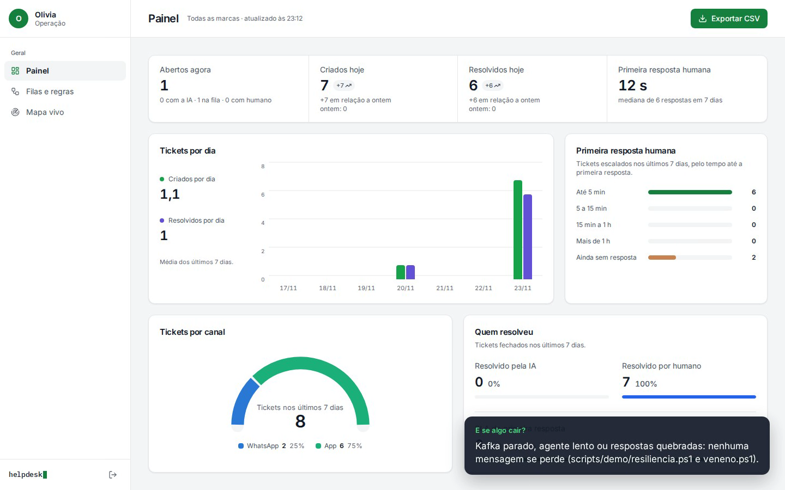
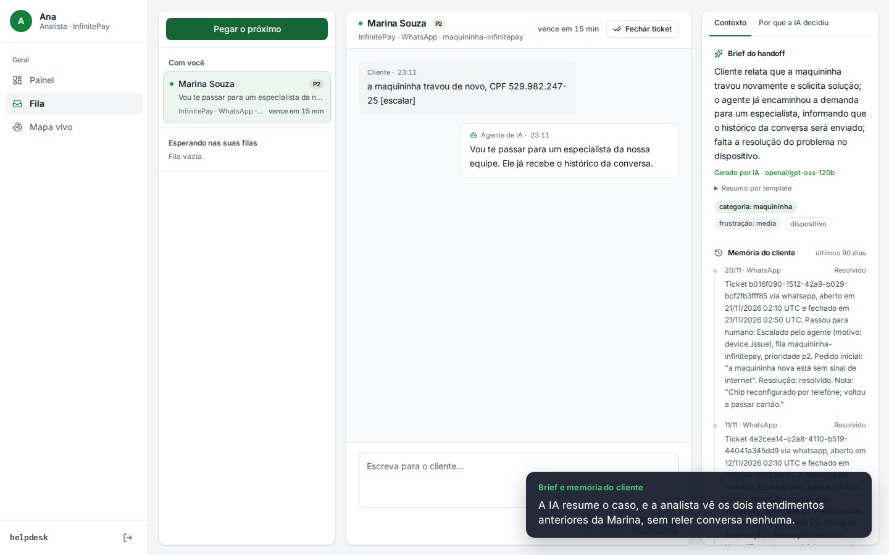
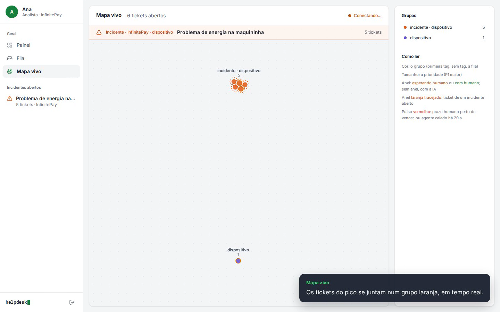
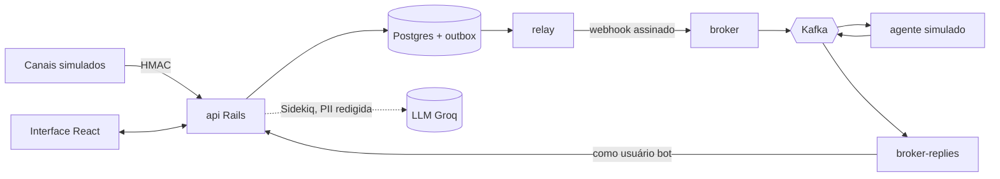

<div align="center">


# Help desk AI-first · CloudWalk

**Atendimento multimarca (InfinitePay e JIM) em que a IA atende primeiro e o humano entra com contexto.**

Projeto acadêmico do Inteli para a CloudWalk · somente dados sintéticos


[Visão geral](#visão-geral) · [Telas](#telas) · [Arquitetura](#arquitetura) · [Como rodar](#como-rodar) ·
[Testes](#testes) · [Robustez](#robustez-e-experimento) · [Documentação](#documentação)

</div>

---

## Visão geral

Um agente de IA (simulado) atende primeiro. A plataforma recebe as mensagens dos canais, faz a triagem e a
priorização com regras versionadas, entrega ao agente por webhook, broker e Kafka, e escala para analistas
humanos com resumo e contexto. Ela também lembra o cliente entre contatos e audita cada decisão.

**Destaques**

- 🤖 **IA no primeiro nível, humano por escalação**: a analista recebe o brief da IA, a memória do cliente e o
  motivo da escalação, sem reler a conversa.
- 🔍 **"Por que a IA decidiu"**: para cada ticket, o texto que a LLM viu (com PII redigida), a regra que casou e
  sua versão, a confiança, os fallbacks e o link para o trace.
- 🚨 **Modo Incidente**: 5 tickets parecidos em 10 min viram um incidente; a analista responde e fecha todos de
  uma vez.
- 🗺️ **Mapa vivo**: os tickets abertos em tempo real, agrupados por assunto.
- ⚙️ **Regras versionadas com dry-run**: a operação simula uma regra nova sobre tickets reais antes de publicar.
- 🛡️ **Confiabilidade comprovada**: zero perda, zero duplicata, ordem e nenhum ticket esquecido, mesmo com o
  Kafka parado ou o agente mandando respostas quebradas.

## Telas

| Painel | Fila da analista |
|---|---|
|  |  |
| Números reais do banco, comparação com ontem, SLA e exportação CSV. | Pegar o próximo ticket, brief do handoff e histórico do cliente. |

| Mapa vivo |
|---|
|  |
| Tickets de um incidente formam um grupo laranja; pulso vermelho indica prazo perto de vencer. |

> As capturas vêm do vídeo de demonstração e podem estar algumas iterações atrás da
> interface atual.

| Rota | O que mostra |
|---|---|
| `#/painel` | Abertos agora, criados e resolvidos hoje contra ontem, tickets por dia, primeira resposta humana, SLA, quem resolveu (IA ou humano) e canais. |
| `#/fila` | A analista pega o ticket mais urgente, conversa e fecha com resolução. Abas **Contexto** e **Por que a IA decidiu**. |
| `#/mapa` | Tickets abertos agrupados, entrando e saindo em tempo real. |
| `#/operacao` | Equipes, filas e regras versionadas, com simulação antes de publicar. |
| `#/cliente` | Chat do cliente simulado, sem login, com o botão "Simular pico". |

Tickets que a IA resolveu fecham sozinhos depois de 30 minutos sem mensagem do cliente.

## Arquitetura



- **Postgres é a verdade.** Cada mensagem entra numa transação só, com outbox; o 2xx sai depois do commit.
- **Kafka só na borda do agente**, com retry-1, retry-2 e DLQ. Entrega at-least-once e efeitos idempotentes.
- **A LLM fornece fatos e escreve textos; quem decide fila e prioridade é a regra.** Se a LLM falhar, tudo segue
  com regras e templates.

A arquitetura completa (componentes, fluxo passo a passo, máquina de estados do handoff, modelo de dados, IA e
observabilidade) está em **[`docs/ARQUITETURA.md`](docs/ARQUITETURA.md)**.

### Stack

| Camada | Tecnologia |
|---|---|
| API e jobs | Ruby on Rails 8.1, Puma, Sidekiq + Redis |
| Mensageria | Apache Kafka 4.3 (KRaft, 1 nó) + Karafka |
| Banco | PostgreSQL 17 |
| Interface | React 19, Vite, TypeScript |
| IA | Groq (modo `live`), com modos `stub`, `replay` e `off` |
| Observabilidade | OpenTelemetry, Jaeger, Prometheus, Grafana |
| Testes | RSpec, Vitest, Playwright + axe, k6 |

### Estrutura do repositório

```
.
├── backend/        plataforma Rails (API, relay, Sidekiq, regras, LLM, prompts)
├── broker/         ponte sem estado entre webhook e Kafka
├── mock_agent/     agente de IA simulado, determinístico e com modo caos
├── frontend/       interface React
├── e2e/            testes ponta a ponta (Playwright) e vídeo da demo
├── experiment/     cenários k6 do experimento oficial
├── observability/  configuração de Prometheus e Grafana
├── scripts/        demo, resiliência, e2e e experimento (PowerShell)
└── docs/           arquitetura, playbook, ADRs, specs e pesquisa
```

## Como rodar

**Pré-requisito:** Docker em execução (Docker Desktop no Windows e no macOS). Não é preciso instalar Ruby nem
Node.

1. Copie as variáveis de ambiente (portas, segredos e credenciais locais):

   ```powershell
   Copy-Item .env.example .env
   ```

2. Suba a pilha:

   ```powershell
   docker compose up -d --build
   ```

3. Abra **http://127.0.0.1:5173**. Em desenvolvimento, a entrada oferece as pessoas de teste: Ana, Bruno e
   Carla (analistas) e Olivia (operação).

> [!TIP]
> Use `127.0.0.1`, não `localhost`: se outro programa ocupar a porta em IPv6, `localhost` cai nele.

Para deixar o banco pronto para uma demonstração (apaga as conversas, mantém a configuração e cria uma cliente
com histórico):

```powershell
docker compose exec api bundle exec rails demo:reset
```

### LLM

O modo vem de `LLM_MODE` no `.env`:

| Modo | Comportamento |
|---|---|
| `stub` (padrão) | Respostas fixas, sem rede |
| `replay` | Respostas gravadas no repositório |
| `live` | Groq, com `GROQ_API_KEY` no `.env` (nunca no repositório) |
| `off` | Sem LLM, só regras e templates |

Antes de qualquer chamada, CPF, cartão, e-mail e telefone são trocados por marcadores.

## Demonstração

O roteiro de 8 a 10 minutos está em [`docs/demo/roteiro-resiliencia.md`](docs/demo/roteiro-resiliencia.md):
Painel → memória do cliente → "Por que a IA decidiu" → Modo Incidente → resiliência ao vivo.

| Script | O que faz |
|---|---|
| `./scripts/demo/resiliencia.ps1 -Cenario kafka` | Derruba o Kafka no meio de uma rajada e confere que nada se perdeu |
| `./scripts/demo/veneno.ps1` | Agente manda respostas quebradas: a plataforma recusa, o broker segue e o vigia passa para humano |

## Testes

Um gate por componente. Os testes usam o Postgres e o Kafka do Compose; nenhum chama rede externa nem LLM.

```powershell
docker compose run --rm test
```

```powershell
docker compose run --rm broker-test
```

```powershell
docker compose run --rm mock-agent-test
```

```powershell
docker compose run --rm web-test
```

**Ponta a ponta** (com a pilha no ar): Playwright percorre a interface de verdade (cliente escreve, agente
escala, analista atende com memória e fecha, um pico vira incidente e é fechado de uma vez), passa o axe
(WCAG 2.1 AA) em todas as telas e faz uma jornada só pelo teclado.

```powershell
./scripts/e2e/run.ps1
```

**Fumaças:** `smoke:round_trip`, `smoke:escalation` e `smoke:routing`, via
`docker compose exec api bundle exec rails <tarefa>`.

## Robustez e experimento

Quatro invariantes valem sempre: **zero perda, zero duplicata, ordem e nenhum ticket esquecido**. Uma rajada
com reentregas grava um ledger, e o verificador confere os quatro depois que o fluxo esvazia:

```powershell
docker compose exec api bundle exec rails "load:burst[300,5,0.2,42]"
```

```powershell
docker compose exec api bundle exec rails "invariants:check[tmp/ledgers/<arquivo>.jsonl,180]"
```

O **experimento oficial** roda em modo de produção, com k6 em taxa de chegada e 30% de reentregas fora de
ordem, em 3 cenários com 3 rodadas cada:

```powershell
./scripts/experiment/run.ps1 -Cenarios S1,S2,S3 -Rodadas 3
```

| Resultado | Valor |
|---|---|
| Invariantes | OK nas 9 rodadas (rampa até 50×, Kafka parado 60 s, agente em caos) |
| Ponta a ponta p99 em 10× | 1,18 a 1,25 s (meta de 1 s perdida por pouco) |
| Recuperação após o Kafka voltar | menos de 1 min |
| Ponto de ruptura | entre 10× e ~37× nesta máquina |

Os números valem como comparação entre cenários, não como capacidade de produção: um host, Kafka de 1 nó e agente
simulado. Detalhes em [`docs/research/2026-11-23-experimento-oficial.md`](docs/research/2026-11-23-experimento-oficial.md).

## Observabilidade

```bash
OTEL_TRACES_EXPORTER=otlp docker compose --profile obs up -d
```

| Ferramenta | Endereço | O que mostra |
|---|---|---|
| Grafana | http://127.0.0.1:3030 | Requisições, latência, outbox, tickets por modo, espera e lag do Kafka |
| Jaeger | http://127.0.0.1:16686 | Cada mensagem como um trace só, da API à resposta do agente |
| Prometheus | http://127.0.0.1:9090 | Métricas cruas |

## Limitações declaradas

- Canais e agente são simulados; o agente é um consumidor único.
- Não há isolamento por linha no banco (RLS), regras em linguagem natural nem estimativa de espera.
- Ninguém é avisado quando o SLA humano estoura (o Painel e o mapa mostram).
- Não foi testado em macOS e Linux.

## Documentação

| Documento | Conteúdo |
|---|---|
| [`docs/ARQUITETURA.md`](docs/ARQUITETURA.md) | Arquitetura completa do sistema |
| [`docs/PLAYBOOK.md`](docs/PLAYBOOK.md) | Regras de trabalho, contratos e plano |
| [`docs/decisions/`](docs/decisions/) | ADRs com as decisões e justificativas |
| [`docs/specs/`](docs/specs/) | Especificação de cada fatia entregue |
| [`docs/research/`](docs/research/) | Ideação, piloto de carga, experimento e auditoria |
| [`docs/context/STATE.md`](docs/context/STATE.md) | Estado atual e próximos passos |
| [`docs/TAPI_cloudwalk.pdf`](docs/TAPI_cloudwalk.pdf) | Brief do parceiro |

## Como contribuir

Toda alteração é feita em branch (`feat/`, `fix/`, `docs/`…), com TDD obrigatório e commits convencionais, e
chega à `main` por pull request com verificação e revisão independente. As regras completas estão em
[`AGENTS.md`](AGENTS.md) e no [`PLAYBOOK.md`](docs/PLAYBOOK.md).
