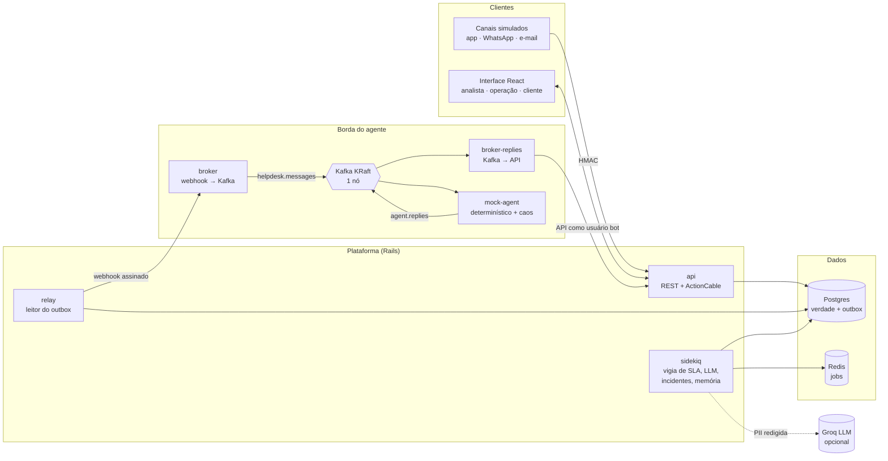
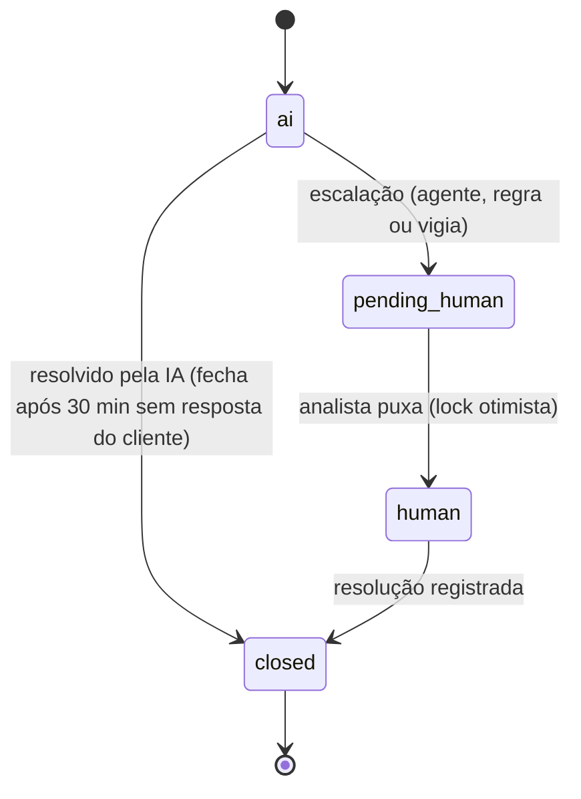
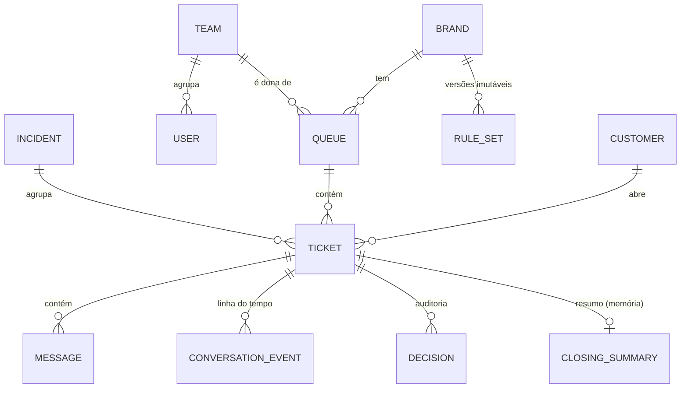
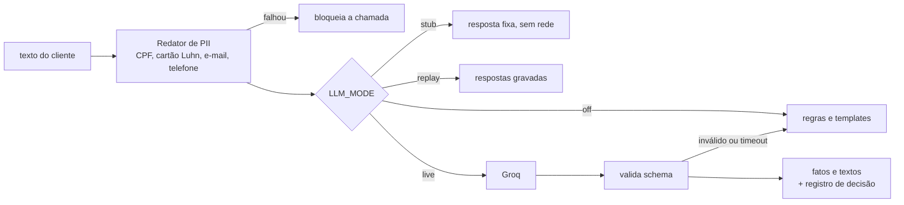

# Arquitetura do help desk AI-first

Visão completa da arquitetura em um só lugar. O **porquê** de cada escolha está nos ADRs em
[`decisions/`](decisions/) (principalmente 0002, 0003, 0004, 0005 e 0008); os contratos operacionais estão no
§3 do [`PLAYBOOK.md`](PLAYBOOK.md). Se este documento divergir do código, o código vale.

## 1. Visão geral

Um monólito modular em Rails (a **plataforma**) é a fonte da verdade, com Postgres. O agente de IA fica do lado
de fora e é alcançado por uma borda assíncrona: webhook assinado → **broker** sem estado → Kafka → agente. A
interface em React conversa com a API por REST e recebe eventos em tempo real por ActionCable.



## 2. Componentes

| Serviço (Compose) | Tecnologia | Responsabilidade |
|---|---|---|
| `api` | Rails 8 (modo API), Puma | Ingestão HMAC, tickets, filas, regras, autenticação, painel, ActionCable |
| `relay` | Rails (processo dedicado) | Lê o outbox por `id` serial e entrega webhooks assinados ao broker |
| `sidekiq` | Sidekiq + Redis | Vigia de SLA, enriquecimento e resumos por LLM, detecção de incidentes, fechamento automático |
| `broker` | Ruby + Karafka, sem estado | Valida a assinatura e publica em `helpdesk.messages`; responde 2xx só depois do Kafka confirmar |
| `broker-replies` | Ruby + Karafka | Consome `agent.replies` e chama a API como usuário `bot` |
| `mock-agent` | Ruby + Karafka | Agente simulado por seed: responde, age ou escala; modo caos opcional |
| `postgres` | PostgreSQL 17 | Fonte da verdade: tickets, mensagens, outbox, auditoria, regras, memória |
| `kafka` | Apache Kafka 4.3 (KRaft) | Fila durável só na borda do agente; retry-1, retry-2 e DLQ |
| `redis` | Redis | Só fila de jobs do Sidekiq (nunca dedupe) |
| `web` | React 19 + Vite + TypeScript | Painel, fila do analista, mapa vivo, operação, chat do cliente |
| perfil `obs` | Jaeger, Prometheus, Grafana, kafka-exporter | Traces ponta a ponta e métricas RED/USE |

### Organização do backend

```
backend/app/
├── controllers/api        REST da plataforma (tickets, fila, painel, mapa)
├── controllers/api/agent  API chamada pelo broker como usuário bot
├── controllers/api/ops    equipes, filas, versões de regras, dry-run
├── controllers/webhooks   entrada dos canais (HMAC)
├── messaging/outbox       outbox transacional e relay
├── services/ingestion     dedupe e gravação atômica da mensagem
├── services/rules         motor de regras JSON versionado
├── services/handoff       máquina de estados e atribuição
├── services/llm           adaptador único (stub, replay, live, off), redator de PII, circuit breaker
├── services/memory        memória do cliente a partir de resumos de encerramento
├── services/incidents     detecção de picos e resposta em lote
├── services/dashboard     métricas do painel
├── services/live          eventos do mapa vivo
├── services/invariants    verificador dos 4 invariantes sobre o ledger
└── jobs                   vigia de SLA, enriquecimento, fechamento automático
```

O frontend separa as telas em `frontend/src/screens/` (`home`, `analyst`, `dashboard`, `map`, `ops`,
`customer`, `detail`, `team`, `resolution`, `tickets`) e os componentes de base em `frontend/src/ui/`.

## 3. Fluxo de uma mensagem

```mermaid
sequenceDiagram
    autonumber
    participant Canal
    participant API as api (Rails)
    participant PG as Postgres
    participant Relay
    participant Broker
    participant Kafka
    participant Agente as mock-agent
    participant BR as broker-replies

    Canal->>API: POST webhook (HMAC)
    API->>PG: 1 transação: inbound_event, mensagem,<br/>ticket, linha do tempo, decisão da regra, outbox
    API-->>Canal: 2xx (só depois do commit)
    Relay->>PG: lê outbox por id
    Relay->>Broker: webhook assinado
    Broker->>Kafka: helpdesk.messages (chave ticket_id)
    Broker-->>Relay: 2xx (só depois do ack do Kafka)
    Kafka->>Agente: consome
    Agente->>Kafka: agent.replies (agent_turn_id, in_reply_to_seq, handoff_epoch)
    Kafka->>BR: consome
    BR->>API: POST como bot (idempotente)
    API->>PG: confere processed_events, seq, epoch e mode; grava
    API-->>Canal: resposta sai pelo outbox
```

Caminhos laterais:

- **Escalação:** o agente pede, o vigia detecta silêncio ou a regra manda. O ticket vai a `pending_human`, as
  regras rodam de novo (fila e prioridade finais) e a LLM escreve o brief.
- **Enriquecimento:** em paralelo, a LLM devolve fatos (categoria, idioma, frustração). Se não chegar no
  orçamento de tempo, o roteamento segue só com regras.
- **Incidente:** 5 tickets parecidos em 10 min (mesma marca e categoria) viram um incidente com título e rascunho
  da LLM; a analista responde e fecha todos de uma vez.

## 4. Handoff entre IA e humano



- Um escritor por vez. O bot só escreve com `mode = ai`.
- Cada troca de dono incrementa `handoff_epoch`; resposta do bot com epoch antigo é descartada e auditada.
- `seq` por conversa sob lock de linha garante ordem de saída.
- Prioridade P1 a P4 (5 min, 15 min, 1 h, 4 h); a analista puxa o ticket de prazo mais próximo.

## 5. Dados



Tabelas de infraestrutura: `inbound_events` (UNIQUE por canal e id do provedor), `outbox`,
`processed_events` (idempotência do agente). As regras vivem como JSON dentro de cada `rule_set`; a memória do cliente é montada a partir dos `closing_summaries` dos tickets anteriores. Cada `decision` guarda ator (regra, LLM, humano, agente), versão
da regra ou do prompt, modelo, confiança, latência, fallback e um hash da entrada redigida, nunca PII crua.

## 6. Mensageria e confiabilidade

| Garantia | Como |
|---|---|
| Nada se perde | 2xx só depois do commit; outbox transacional; Kafka com ack antes do 2xx do broker |
| Sem duplicata | `inbound_events` UNIQUE na entrada; `processed_events` pelo `agent_turn_id` na volta |
| Ordem | `seq` por conversa; chave de partição `ticket_id` |
| Sem órfãos | vigia de SLA (Sidekiq) escala ticket silencioso ou sem dono |
| Mensagem envenenada | retry-1 → retry-2 → DLQ com listar, purgar e reprocessar; partição nunca trava |

Tópicos: `helpdesk.messages`, `agent.replies` e os derivados `*.retry-1`, `*.retry-2`, `*.dlq`. O Kafka existe
só na borda do agente; dentro da plataforma, o Postgres é a fila (ADR 0003).

## 7. IA na plataforma



- A LLM **fornece fatos e escreve textos** (brief, resumo de encerramento, incidente). Fila e prioridade são
  sempre da regra.
- Prompts versionados em `backend/prompts/<tarefa>/vN`; respostas de replay em `backend/llm_replay/`.
- Circuit breaker por dependência; nenhum teste automatizado nem de carga chama LLM real.

## 8. Motor de regras

Regras por marca, ordenadas, a primeira que casa vence. Condições em árvore JSON (`all`/`any`, `fact`, `op`,
`value`); ações só de fila, prioridade e tags. Cada publicação é uma versão imutável, com **dry-run** sobre os
últimos tickets antes de publicar. Cada decisão grava a versão e a regra que casou.

## 9. Tempo real

O mapa vivo e a fila recebem eventos de ticket (aberto, atualizado, fechado) por ActionCable, agrupados a cada
~250 ms; a carga inicial vem por REST. O mapa desenha em canvas, com teto de nós e sobra resumida.

## 10. Observabilidade

OpenTelemetry com o contexto propagado nos headers do Kafka: cada mensagem é um trace só, da API à resposta do
agente (Jaeger). Prometheus coleta métricas RED dos serviços, idade do outbox, tickets por modo e lag do
consumidor; o Grafana as mostra. Tudo sobe com `docker compose --profile obs up -d`.

## 11. Implantação e ambientes

| Arquivo | Uso |
|---|---|
| `compose.yaml` | Desenvolvimento, testes de cada componente e perfil `obs` |
| `compose.pilot.yaml` | Pilha em modo de produção para medidas |
| `compose.experiment.yaml` | Experimento oficial com k6 |

Tudo roda em containers; não é preciso Ruby nem Node na máquina.

## 12. Limites conhecidos

Kafka de 1 nó e um host só; agente simulado e consumidor único; sem RLS no banco; alerta de SLA humano só
visual; não testado em macOS e Linux. Detalhes e números em
[`research/2026-11-23-experimento-oficial.md`](research/2026-11-23-experimento-oficial.md).
